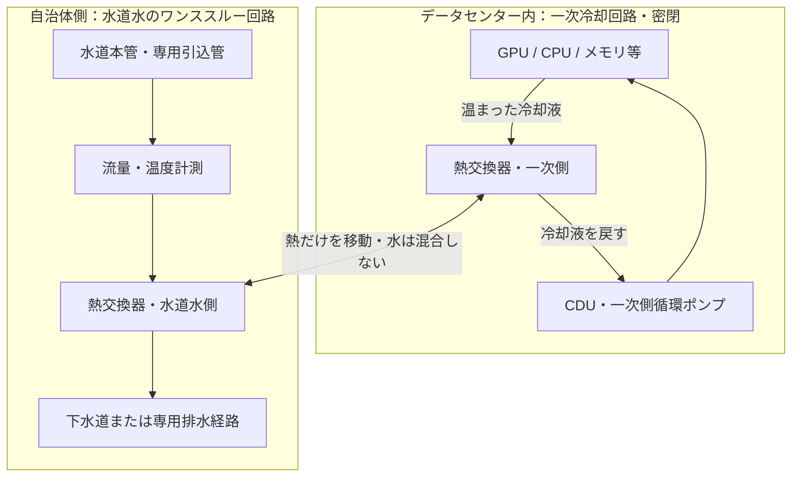

## 1. 要約

本レポートは、AIデータセンターの熱を、自治体の水道水を使った一方向の熱交換で回収する構想を検討する。

想定する方式は、次のとおり。

- GPU・CPUなどのIT機器側は、冷却液を循環させる**独立した密閉一次回路**とする。
- 一次回路の熱を、プレート式などの熱交換器で水道水側へ渡す。
- 水道水側は水道本管の圧力で流し、熱交換後は下水道へ排出する。
- 水道水とIT機器側の冷却液は混合させない。
- 冷却塔、屋外ラジエーター、大型屋外ファン、蒸発冷却を原則として使わない。
- ポンプや補助設備は可能な限り建物内の防音・防振機械室に収容する。

これは「冷却水を閉ループで循環させる」方式ではなく、
**IT側だけを閉ループ化し、水道水側は一度通して排水するワンススルー冷却**である。
蒸発による水の消費を避け、屋外の冷却設備を減らせる点が特徴となる。

### 一次評価

技術的には成立する。特に、札幌のように給水温度が比較的低い地域では、
チラーや蒸発冷却塔を使わずに液冷回路から熱を取り出せる時間が長くなる可能性がある。

ただし、100MW級の熱負荷では必要水量が非常に大きい。
札幌市の2025年度の日平均配水量約52.8万m³に対して、
100MWの熱を水温上昇15℃で運ぶと約13.8万m³/日、約26%に達する。
既存水道網の余裕だけで供給できるとは仮定できず、
専用配水管・供給能力・下水道経路を含むインフラ計画が必要である。[1][ref-1]

また、水道料金を冷却用途について無料にすることは政策として設計できるが、
浄水・送配水・配管保守・下水輸送の実費がゼロになるわけではない。
固定サブスクリプション等で回収するのか、公共負担として補助するのかを明示する必要がある。

## 2. 構想の定義

### 2.1 基本構成



上図の「一次回路」はサーバー側で閉じた回路であり、水道水は熱交換器を一度通って排出される。
したがって、水道水をGPUの冷却液として直接流す構成ではない。

### 2.2 ポンプについて

水道本管の残圧が、引込管・メーター・フィルター・熱交換器・バルブ・排水管の圧力損失を上回るなら、
水道水側は施設内の加圧ポンプなしで流せる可能性がある。これは構想の重要な利点である。

ただし、次の点は分ける必要がある。

1. **水道水側**：本管の圧力・水頭を使って流せる設計なら、施設内ブースターポンプを省ける可能性がある。
2. **サーバー側一次回路**：GPU・CPUの冷却液をラック間・コールドプレート間で循環させるため、
   通常は一次側の循環ポンプが残る。これを建物内の防音機械室へ置くことはできる。
3. **水道事業者側**：施設内にポンプがなくても、取水・浄水・配水の上流設備に必要な動力が消えるわけではない。
   札幌市は地形を利用した自然流下配水を多く採用しているが、対象地点への大流量供給で
   追加ポンプや増強が必要かは個別の水理計算が要る。[2][ref-2]

したがって、「施設の外に冷却ポンプを置かない」「施設内の水道側ポンプをなくす」は狙えるが、
「システム全体からポンプをなくす」とは異なる。

## 3. 熱収支と必要水量

### 3.1 計算条件

水が運ぶ熱量は、次式で近似できる。

```math
Q = \dot{m} c_p \Delta T
```

- $Q$：熱負荷（W）
- $\dot{m}$：水の質量流量（kg/s）
- $c_p$：水の比熱。概算で4,186 J/(kg·K)
- $\Delta T$：水道水の入口と出口の温度差（K）

水の密度を約1,000kg/m³とし、熱負荷が連続しているものとして計算する。
ここでいうMWは、データセンターが排出する**熱負荷MWth**であり、
IT機器の定格電力と常に同一という意味ではない。

### 3.2 必要流量

| 熱負荷 | 水温上昇10℃ | 水温上昇15℃ | 水温上昇20℃ |
| ---: | ---: | ---: | ---: |
| 10MW | 約20,600m³/日 | 約13,800m³/日 | 約10,300m³/日 |
| 50MW | 約103,200m³/日 | 約68,800m³/日 | 約51,600m³/日 |
| 100MW | 約206,400m³/日 | 約137,600m³/日 | 約103,200m³/日 |

温度差を大きく取るほど必要流量は減る。ただし、出口水温、機器側の許容冷却液温度、
季節ごとの給水温度、熱交換器の温度差・性能を同時に満たさなければならない。

### 3.3 札幌市の配水量との比較

札幌市の2025年度水道事業年報による日平均配水量は527,893m³/日である。[1][ref-1]

| 100MW熱負荷の条件 | 必要水量 | 札幌市の日平均配水量に対する比率 |
| --- | ---: | ---: |
| 水温上昇10℃ | 約206,400m³/日 | 約39.1% |
| 水温上昇15℃ | 約137,600m³/日 | 約26.1% |
| 水温上昇20℃ | 約103,200m³/日 | 約19.5% |

この比較から、100MW級を単一の既存水道区域で賄う場合、無視できる追加需要ではないことが分かる。
10MW級なら、水温上昇15℃で約13,800m³/日、札幌市全体の日平均配水量の約2.6%であり、
実証・段階導入の候補としては相対的に扱いやすい。

なお、市全体の配水量比率は参考値にすぎない。実際の供給可否は、接続する配水区・幹線の時間最大流量、
圧力、他需要家の同時使用、消防用水・災害時の供給余力で決まる。

### 3.4 札幌の水温との関係

札幌市水道局が公表する令和6年度の白川浄水場給水栓水の例では、
水温は5.1～19.9℃、平均11.4℃である。[3][ref-3]

この温度帯なら、水温上昇15℃のケースで出口水温は概ね20.1～34.9℃となる。
水温上昇20℃でも概ね25.1～39.9℃である。したがって、少なくとも公開された水温例の範囲では、
十分な温度差を確保できる季節が期待できる。

ただし、この数値は白川浄水場給水栓水の年度データ例であり、札幌市内すべての配水区・
すべての時間帯で同じ水温になることを保証するものではない。
大流量を流した場合の実際の入口温度は、接続地点で連続測定する必要がある。

また、IT機器側では結露を防ぐため、冷却液温度を室内空気の露点より十分高く制御する必要がある。
水道水が冬季に非常に冷たくなる場合には、熱交換器のバイパスや混合制御を使い、
一次回路の供給温度を下げすぎない設計が適切である。

## 4. 配管と水道圧力

### 4.1 100MW級の配管規模

水道水側の流速を仮に2m/sとした場合、必要な内径の概算は次のとおり。

| 100MW熱負荷 | 流量 | 流速2m/sでの管内径概算 |
| --- | ---: | ---: |
| 水温上昇10℃ | 約2.39m³/s | 約1.23m |
| 水温上昇15℃ | 約1.59m³/s | 約1.01m |
| 水温上昇20℃ | 約1.19m³/s | 約0.87m |

これは流速から求めた概算内径であり、最終的な管径ではない。
管長、粗度、継手、バルブ、メーター、ストレーナー、熱交換器の圧力損失、許容水撃、
停電時の弁動作などを含めて水理設計する必要がある。

100MW級では、一般建物の給水引込管ではなく、専用の大口径管・専用接続設備を前提に考えるべき規模である。

### 4.2 施設内ポンプを省ける条件

施設内ブースターポンプを省略できる条件は、概念的には次のとおり。

```math
H_{\rm available} > H_{\rm pipe} + H_{\rm HX} + H_{\rm meter} + H_{\rm valve} + H_{\rm discharge}
```

水道本管の利用可能水頭が、引込管・熱交換器等の損失水頭を上回っている必要がある。
距離だけでは決まらず、流量が大きいほど配管損失は増える。
熱交換器の圧力損失が大きければ、短距離でも必要水頭を満たせない。

札幌市は直結直圧・加圧給水について、建物規模・給水装置・使用予定水量を示した事前協議を案内している。
[4][ref-4] 100MW級の冷却用途は、通常の建物給水とは別に、
配水区の水理モデルによる個別協議が必要と考えられる。

### 4.3 圧力を使うことは、エネルギーが無料という意味ではない

施設内ポンプを省ければ、施設内の騒音・振動・保守を減らせる。
一方、水道事業者が上流の浄水場・ポンプ場・配水施設で負担する電力や設備費は残る。

札幌市の2025年度水道事業年報では、年間配水量192,680,890m³に対し、
動力使用量の総計は24,237,783kWhと記載されている。[1][ref-1][5][ref-5]
単純除算した参考平均は約0.126kWh/m³である。
これを100MWth・水温上昇15℃のケース（約137,600m³/日）に機械的に当てはめると、
約17.3MWh/日、平均約0.72MW相当となる。
水温上昇10℃なら約26.0MWh/日、平均約1.08MW相当である。

ただし、これは市全体の平均動力原単位であり、追加供給の限界電力ではない。
札幌市は地形を活用した自然流下配水を多く採用していると説明しており、
対象配水区が重力流下で供給できるなら追加動力は平均より小さい可能性がある。
一方、追加幹線・高区配水・ポンプ増強が必要なら平均より大きくなる可能性もある。[2][ref-2]
したがって、対象地点の流量・標高・圧力条件と上流経路を使った水理計算、実測電力量で評価する必要がある。

## 5. 下水道への排出

### 5.1 水質負荷と水量負荷は別

水道水を熱交換器に通しただけで、油・薬品・金属・有機物などを混入させなければ、
通常の生活排水や製造工程排水と比べて有機物負荷は小さいと考えられる。

しかし、下水道にとっては次の負荷が残る。

- **水量・水理負荷**：下水管、ポンプ場、処理場へ流れる水量が増える。
- **熱負荷**：温水が合流管・処理場に流入し、下水温度を上げる。
- **設備・維持管理負荷**：流量計測、受入配管、ポンプ場、管路保守などが必要になる。

札幌市は市内10か所の水再生プラザで、合計約100万m³/日の下水を処理していると公表している。[6][ref-6]
100MWの排熱を水温上昇15℃で回収する場合、排水量は約13.8万m³/日であり、
この市全体の処理量の約13.8%に当たる。水温上昇10℃なら約20.6%である。

これは市全体の概算比較であり、各処理区の実際の余力を示すものではない。重要なのは、
**有機物処理能力をあまり使わない水であっても、管路・ポンプ・処理場の水量容量を使う**という点である。
特定の処理区に大量排水が集中すれば、下水道側の増強が必要になり得る。

### 5.2 排水温度

札幌市の下水水質基準表では、温度は45℃未満とされている。[7][ref-7]
ただし、これは排水温度の基準の一つであり、45℃未満ならどれほど大量でも
無条件に受け入れられる、という意味ではない。
事業場排水には他の水質基準・届出・協議も関係する。[8][ref-8]

札幌市の公表水温例（最大19.9℃）に対して15℃上昇させた場合、出口は最大約34.9℃となる。
温度基準には余裕があるように見えるが、合流先の水温、季節、流量、
処理場の生物処理条件を含む事前協議が必要である。

### 5.3 下水道を使わない選択肢

大量の比較的清浄な冷却排水を、通常の汚水と同じ下水道へ全量流すことが最適とは限らない。
自治体・河川管理者との協議を前提に、次の選択肢も比較対象となる。

- まず地域熱供給・給湯・融雪・温室などで熱を二次利用し、その後に排水する。
- 再生水・工業用水・河川水など、飲料水以外の冷熱源を使う。
- 専用の冷却水戻り管を設け、放流先の温度・水質・生態系条件を確認したうえで公共用水域へ戻す。

これらは許認可や熱環境評価が必要であり、下水道排出より単純とは限らない。
ただし、100MW級では下水道の水量負荷を避けるために比較する価値がある。

## 6. 水道料金・限界費用・サブスクリプション

### 6.1 料金と追加コストは同じではない

水道料金は水道事業の総括原価を利用者間で配分する制度であり、
追加で1m³流したときの限界費用そのものではない。
日本水道協会の2025年版「水道料金算定要領」は、需要家費・固定費・変動費を分け、
薬品費や動力費などを変動費として扱っている。[9][ref-9]

この区別は、冷却専用水の料金設計で重要になる。

- 既存設備に余力があり、自然流下で供給できる時間帯・地点なら、
  追加の現金支出は既存設備の償却費全額を再度負担させる場合より小さくなり得る。
- ただし、追加取水・浄水・消毒・送配水の薬品・電力・監視費用は残る。
- 大流量を安定供給するための配水管、分岐、メーター、弁、予備系統の建設費は、
  容量を確保するための追加費用になる。
- 水道水が下水へ流れるなら、下水側の輸送・管路・ポンプ・処理設備にも追加コストがある。

従って、ユーザー側の従量料金をゼロに設定することは可能でも、社会全体の追加コストがゼロになるわけではない。
ゼロ従量料金を政策として採用する場合、固定サブスクリプション・自治体負担・産業振興予算の
どれが費用を負担するのかを明示する必要がある。

### 6.2 札幌市の現行料金制度との関係

札幌市の公表料金では、事業用水道の大口径区分があり、
口径200mm超は管理者が別に定める額とされている。[10][ref-10]
下水道使用料は2026年10月に改定され、また冷房・冷却機器から直接下水道へ排水する水については、
条件・申請により使用料の50%減額対象となる制度が掲載されている。[11][ref-11]

この現行制度は、冷却用途を無料にする提案とは異なる。
したがって、構想を実装するなら、既存の一般水道料金に単純に当てはめるのではなく、
自治体と事業者が容量・流量・供給信頼度・排水経路を契約する専用メニューが必要になる。

### 6.3 推奨する料金モデル

提案するのは、単純な「使用量完全無制限・無料」ではなく、次のような容量予約型サブスクリプションである。

| 料金要素 | 推奨方式 | 根拠 |
| --- | --- | --- |
| 冷却水の従量料金 | 契約容量内はゼロ、または政策的に大幅減免 | 蒸発・消費ではなく熱輸送用途として扱う |
| 接続・専用配管 | 初期負担または長期リース | 個別需要に起因する設備費 |
| 供給容量予約 | MWthまたはm³/s単位の固定月額 | 供給能力を確保する固定費 |
| 追加のポンプ電力・薬品費 | 実測値に基づく原価連動、または固定料金に内包 | 上流の変動費を隠さない |
| 下水道利用 | 実際の追加水量・水理負荷・処理負荷で別建て | 下水道側の負担を水道料金に混ぜない |
| インフラ増強 | 原因者負担を基本とし、地域便益分は公費分担 | 施設単独の便益と地域共通の便益を分ける |

利用者にとっての「冷却水無料」は、従量課金をなくし、固定契約で予見可能なコストにするという意味で実現できる。
自治体側の追加費用が残る場合には、サブスクに含めるか、産業政策として公費負担するかを決める必要がある。

## 7. 騒音・静音化の効果

### 7.1 屋外騒音源を減らす

従来型のデータセンターでは、冷却塔ファン、屋外チラー、ドライクーラー、コンデンサー、
排気ファンなどが敷地外への連続騒音源になり得る。
水道水側のワンススルー熱交換で十分な排熱ができれば、これらの屋外設備を大幅に減らす、または不要にできる。

特に、冷却設備を建物内へ収容することで、敷地境界に直接露出するファン・コンプレッサーの数を減らせる。
日本国内でもデータセンターの騒音・低周波音・排熱への住民懸念が国会で取り上げられており、
立地地域との調和は実務上の課題である。[12][ref-12]

### 7.2 建物内に置けば無音になるわけではない

騒音源を建物内に移すことは有効だが、音は次の経路で外部へ伝わる。

- 外壁・屋根・窓からの空気伝搬音
- 換気口・給排気ダクト・ケーブル貫通部からの漏洩
- ポンプ・圧縮機・変圧器の振動が床・基礎・配管へ伝わる固体伝搬音
- 非常用発電機の排気・吸気・試運転音

ASHRAEの騒音・振動制御資料は、機械室の配置、防振架台、配管・ダクトの弾性支持、
ダクト消音器、機械室の遮音などを対策として挙げている。[13][ref-13]

したがって、目標は「建物内に置くから無音」ではなく、
**屋外に連続運転する大型冷却機器を置かず、建物外周での騒音・振動を設計値以下に抑えること**である。

### 7.3 液冷化の対象

| 対象 | 冷却方法・期待効果 | 注意点 |
| --- | --- | --- |
| GPU・CPU | コールドプレート等の直接液冷 | 全部品が液冷対象とは限らず、局所ファンが残る場合がある |
| メモリ・SSD・ネットワーク機器 | 液冷コールドプレート、液冷ラック設計等 | 機器密度・メーカー対応に依存 |
| UPS・整流器・インバーター | 電力変換部の液冷 | 絶縁・漏水検知・保守性が必要 |
| 変圧器 | 油冷回路と水側熱交換器の組み合わせ等 | 電磁音は液冷だけでは消えない |
| 一次側ポンプ | 屋内の独立機械室、防振架台 | ポンプ音と配管振動は残る |
| 非常用発電機 | 屋内防音室、吸排気消音 | 試運転・排気・燃焼音は別途対策が必要 |

冷却塔や屋外ファンをなくせても、変圧器の電磁音、ポンプ音、非常用発電機、排気設備などは残る。
近隣での「ほぼ無音」を目指すことは可能でも、完全無音は現実的な設計目標ではない。

## 8. 信頼性・安全性

水道直結冷却は、水道事業者の事故・断水・幹線工事・水圧低下が
IT設備の冷却に直接影響する単一障害点になり得る。
AIデータセンターは連続稼働が前提であるため、次の冗長化が必要になる。

1. **二系統以上の供給経路**：可能なら異なる配水系統から供給を受ける。
2. **短時間の蓄熱・蓄冷**：水道が停止しても、切替えまで冷却を維持する。
3. **非常用の独立排熱手段**：乾式冷却器・予備チラーなどを非常時専用で用意する。
4. **供給制限時の優先制御**：水道事業者が災害・渇水・火災対応で供給制限する場合に、
   一般生活・消防用水を優先できる契約と制御を設ける。
5. **逆流・交差汚染対策**：一次側冷却液が熱交換器の故障で飲料水側へ混入しないよう、
   二重壁熱交換器、漏えい検知、逆流防止等を組み合わせる。
6. **水撃・急閉止対策**：大流量弁の急閉止、停電時の弁動作、配管破損を考慮する。

このため、通常時は無音に近い水道冷却、非常時は別系統で冷却を維持する構成が適切である。
非常用の乾式設備が存在しても、通常運転中の連続騒音を抑えるという目的は維持できる。

## 9. 実装モデル

### 9.1 小規模実証

最初から100MWを対象にするのではなく、1～10MWth程度の実証設備で以下を測定する。

- 水道水の入口温度・圧力・流量の季節変動
- 熱交換器の圧力損失と熱交換性能
- 施設内ブースターポンプの有無
- 一次側ポンプ電力
- 下水への排水温度・流量
- 水道・下水道の追加電力・薬品・保守費
- 敷地境界の騒音・低周波音・振動
- 断水・水圧低下時のバックアップ動作

### 9.2 100MW級の拡張

実証の結果を基に、100MW級では次の単位でモジュール化する。

- 10MWth程度の独立冷却ブロックを複数配置
- 各ブロックに熱交換器・流量計・温度計・遮断弁を設置
- 水道水側の専用幹線を分岐して供給
- 下水側は処理区ごとの余力・温度・ポンプ能力に合わせる
- 水道停止時は独立した予備排熱系へ切り替える

ただし、100MW級の水道流量は札幌市全体の配水量の約2～4割に相当する条件があり、
単純なモジュールの足し算で既存配水網に接続できるわけではない。
配水区をまたぐ専用幹線、産業用水系統、再生水・河川水系統との比較が必要である。

## 10. 主なリスク・未確定事項

| 項目 | 評価 | 次に必要な確認 |
| --- | --- | --- |
| 熱交換技術 | 成立可能 | 機器メーカーの水温・流量・圧力条件 |
| 札幌の給水温度 | 比較的有利な公開実績あり | 接続候補地点で連続測定 |
| 施設内水道ポンプ不要化 | 条件付きで可能 | 配水区の残圧と全圧力損失の水理計算 |
| 一次側循環ポンプ | 通常は必要 | ポンプ選定・防振・冗長化 |
| 100MWの給水量 | 既存網に対して非常に大きい | 専用幹線・供給能力・消防水量との調整 |
| 下水道容量 | 有機物負荷は低くても水量・熱負荷あり | 放流先処理区の時間最大流量・余力を確認 |
| 水道水無料制度 | 政策設計として可能 | 固定料金・変動費・公費負担の会計設計 |
| 近隣騒音 | 大幅低減の余地 | 建屋遮音・防振・ダクト消音・境界測定 |
| 無停止運転 | 水道単独では不十分 | 二系統給水・蓄熱・非常用排熱設備 |

## 11. 結論

この構想の中核は、水を大量に「消費」する冷却塔ではなく、
自治体の水道水を熱輸送媒体として使い、熱交換後に排水する点にある。
IT機器側を密閉液冷にすれば、サーバー側冷却液の蒸発損失は発生せず、水道側も蒸発を伴わない。

さらに、通常運転時に屋外の冷却塔・大型ファン・チラーを置かず、
ポンプ・熱交換器などを建物内の防音機械室へ収容すれば、
データセンターの敷地境界騒音を大幅に減らせる可能性がある。

一方、100MW級では必要水量が1日10万～20万m³規模に達する。
これは札幌市の平均配水量に対して約2～4割となる条件であり、
上水道・下水道ともに「既存容量に余裕があるから無償で流せる」とは判断できない。
下水道では有機物負荷と水量負荷を分けて評価する必要がある。

そのため、最も現実的な政策・事業モデルは、自治体が冷却専用の熱輸送サービスを提供し、
事業者が供給容量を予約する方式である。
冷却水の従量料金を無料または大幅減免とし、配管・保守・上流動力・下水道負荷は
固定サブスクリプションや公費負担で透明化する。
水道本管の残圧を利用できる地点では、施設内の水道側ポンプを省略できる可能性もある。

**総合評価：技術的に成立し得るが、100MW級の実現性を決めるのは熱交換器よりも、
専用水量の確保・圧力・下水道経路・冗長性・費用配分である。**
まずは1～10MWthの実証で水温、圧力、流量、排水温度、騒音、追加運転費を計測し、
自治体インフラと一体の冷却サービスとして拡張するのが妥当である。

## 参考資料

[1][ref-1] 札幌市水道局「令和7年度（2025年度）水道事業年報」浄水統計。
2025年度の年間配水量192,680,890m³、日平均527,893m³。

[2][ref-2] 札幌市議会資料「省エネルギーの推進」。
豊平川扇状地等の地形を利用し、全給水量の約8割を自然流下方式で配水する旨の説明。

[3][ref-3] 札幌市水道局「水質検査結果」。
令和6年度の白川浄水場給水栓水の例として水温5.1～19.9℃、平均11.4℃。

[4][ref-4] 札幌市「直結直圧・加圧給水の事前協議」。建物規模、給水装置、使用予定水量等を事前確認。

[5][ref-5] 札幌市水道局「令和7年度（2025年度）水道事業年報」浄水統計・動力使用状況。

[6][ref-6] 札幌市「下水道の現況」。市内10か所の水再生プラザで約100万m³/日の下水を処理。

[7][ref-7] 札幌市「下水の水質基準について」。下水水質基準表の温度基準。

[8][ref-8] 札幌市「工場・事業場の排水規制」。事業場排水の水質基準、特定施設・除害施設の届出等。

[9][ref-9] 日本水道協会「水道料金算定要領（令和7年2月）」。需要家費・固定費・変動費の区分。

[10][ref-10] 札幌市水道局「水道料金の計算方法」。事業用の口径別料金、200mm超は管理者が別に定める額。

[11][ref-11] 札幌市「下水道使用料」。
冷房・冷却機器から直接下水道に排水する水の50%減額制度、2026年10月改定後の料金。

[12][ref-12] 衆議院「第221回国会 決算行政監視委員会 第2号（2026年6月3日）」。
データセンターの騒音・低周波音・排熱等に関する地域懸念の質疑。

[13][ref-13] ASHRAE Handbook, Chapter 49 “Noise and Vibration Control”。
機械室、防振支持、ダクト消音、配管振動絶縁等。

[14][ref-14] U.S. Department of Energy, “Cooling Water Efficiency Opportunities for Federal Data Centers”。
冷却塔の蒸発・ブローダウンと水側エコノマイザー。

[15][ref-15] ITU-T Recommendation L.1327 (2024),
“Guidelines on the selection of cooling technologies for data centres in multiple scenarios.”

[16][ref-16] “Data centre water consumption”, npj Clean Water (2021).
データセンター冷却における水使用、冷却方式、温度条件の分析。

---

## 付録：主な計算式

流量（m³/s）は、熱負荷をMWth、水温上昇を℃で指定した場合、次式で概算できる。

```math
\dot V = \frac{Q_{MW} \times 10^6}{1000 \times 4186 \times \Delta T}
```

1日当たりの水量は、流量に86,400秒を乗じる。

管内径は平均流速を仮定し、次式で算出する。

```math
D = \sqrt{\frac{4\dot V}{\pi v}}
```

ここで、$v$ は管内平均流速（m/s）。本レポートの内径試算は$v=2$m/sを仮定した概算である。

## 取り込み記録

- 原本：添付されたMarkdown原稿（GPT-6、2026-11-09T20:01:00+09:00）。
  SHA-256：`ad057cbffdf5b138b2f7705f0c02df1ef712fd51ff0359a25de95b8f1a274993`。
- 原本の文書種別は `Technical-Feasibility-Report`、状態は「調査に基づく概念設計・一次評価」。
  リポジトリでは `type: Report`、`status: draft` に対応させ、生成者・原本生成日時は保持した。
- 本文の主張・数値・出典は原稿を保持し、frontmatter・見出し・数式のMarkdown記法・引用リンク・改行のみ整えた。
  以下の検証記録は原稿本文とは区別する。

### 取り込み時の計算確認と留保（2026-11-09）

本節は取り込み時に追加した編集注であり、原稿の一部ではない。
独立した計算確認と主担当の再計算では、必要水量・比率・管径・動力・出口水温は概算の丸め範囲で一致した。
例えば100MWth・水温上昇15Kでは137,601.53m³/日、527,893m³/日に対する比率は26.0662%である。
算術の一致は、入力統計の真正性や設備・制度の実現性を保証しない。

1. **熱交換の成立条件（1節・3.4節）**：給水温度だけでは機器側の冷却成立を確定できない。
   一次側往復温度、熱交換器の両端アプローチ温度差、伝熱能力・流量の整合を確認する必要がある。
   例えば入口19.9℃・上昇20Kの出口39.9℃に対し、一次側戻り温度にはさらに所要アプローチ分の余裕が要る。
   「技術的には成立する」は、これらの条件を満たす場合の構想として扱う。
2. **料金制度の可否（6節）**：ゼロ従量料金・固定契約は制度提案であり、
   現行法令・条例・供給規程との適合性を確認した結論ではない。既存の減額制度とも区別する。
3. **非蒸発と取水・使用の区別（6.3節・11節）**：装置内での蒸発損失を避けても、
   上水の取水・浄水・配水と下水の容量使用は残る。「消費しない」を「取水・使用しない」と読んではならない。
4. **静音性能（7節・8節）**：「無音に近い」は未実証の設計目標として扱う。
   騒音低減量や敷地境界での性能は、音響設計・測定なしに確定できない。

### 取り込み時の出典照合（2026-11-09）

独立した資料確認と主担当の確認をまとめた記録である。URLへの到達と本文内容の確認は区別した。
取得失敗・文字化け・抽出打切りは、原稿の事実誤りを示すものではない。

| 資料 | 今回確認できた範囲 | 未確認事項・適用上の注意 |
| --- | --- | --- |
| [1][ref-1] | 2025年度年報の案内ページ、2026-11-05更新、浄水統計へのリンク | 配水量・動力の原表数値は未確認 |
| [2][ref-2] | PDFの取得まで | 抽出本文を閲覧できず、自然流下「約8割」は未確認 |
| [3][ref-3] | 令和6年度白川浄水場給水栓水の5.1～19.9℃・平均11.4℃ | 全配水区・全時間帯を保証する値ではない |
| [4][ref-4] | 申請ページへの到達まで | 文字化けにより、事前協議の具体的な確認項目は未確認 |
| [5][ref-5] | PDFの取得・テキスト抽出処理の成功まで | 抽出本文を閲覧できず、192,680,890m³・527,893m³/日・24,237,783kWhは未確認 |
| [6][ref-6] | 10処理区・10プラザ、約100万m³/日の説明 | 2023-07-11更新の概況であり、現在の受入余力ではない |
| [7][ref-7] | 水質規制の案内本文 | 基準表画像を確認できず、「45℃未満」の値は未確認 |
| [8][ref-8] | 排水の水質規制、特定施設・除害施設の届出の説明 | 本構想の個別施設にどの届出が必要かを確定したものではない |
| [9][ref-9] | 取得失敗・接続タイムアウト | 2025年版の内容、費用分類、薬品費・動力費の扱いは未確認 |
| [10][ref-10] | 200mm超の料金が「管理者が別に定める額」との記載 | 無料化の根拠ではない |
| [11][ref-11] | 2026-10-01改定後料金と冷房・冷却機器からの直接排水の使用料50%減額 | 自己負担の計測メーター・申請・事前相談が条件。排水量50%減少という意味ではない |
| [12][ref-12] | 2026-06-03の指定会議録、騒音・低周波音・排熱への住民懸念の質疑 | 懸念の存在の根拠であり、被害や静音性能の測定証明ではない |
| [13][ref-13] | 第49章の題名、屋外音・配管等を経由する振動の説明 | 抽出打切りのため、個別対策の列挙は全項目を照合できていない |
| [14][ref-14] | 表題まで | 本文抽出が打ち切られ、蒸発・ブローダウン・エコノマイザーの説明は未確認 |
| [15][ref-15] | 原URLはHTTP 500。代替の[ITU公式書誌][itu-bibliography]でL.1327（08/24）・表題・2024-08-29承認を確認 | 規格本文は未確認。原本のURLは保持し、代替の所在を本注に記録した |
| [16][ref-16] | 認証・Cookieを介するページへの到達まで | 論文本文を確認できず、内容の裏付けは未判定 |

特に[1][ref-1]・[5][ref-5]の統計値、[2][ref-2]の自然流下比率、[7][ref-7]の温度基準、
[9][ref-9]の費用分類は未確認として残す。PDF取得や算術の一致を、出典本文の確認の代わりにしていない。
[14][ref-14]～[16][ref-16]は原稿本文中の番号引用がない補足文献であり、本構想全体を支持すると判定していない。

[itu-bibliography]: https://www.itu.int/rec/T-REC-L.1327-202408-I/en
[ref-1]: https://www.city.sapporo.jp/suido/riyosya/plan/r7_nenpou.html
[ref-2]: https://www.city.sapporo.jp/gikai/html/documents/05_kensetu_1209_siryou5.pdf
[ref-3]: https://www.city.sapporo.jp/suido/overview/suishitu/result/
[ref-4]: https://www3.city.sapporo.jp/download/shinsei/search/procedure_view.asp?ProcID=3124
[ref-5]: https://www.city.sapporo.jp/suido/riyosya/plan/documents/04_07nenpou-zyousui-toukei.pdf
[ref-6]: https://www.city.sapporo.jp/gesui/01yakuwari/03_genkyo01.html
[ref-7]: https://www.city.sapporo.jp/gesui/03otoiawase/suishitsukijyun.html
[ref-8]: https://www.city.sapporo.jp/gesui/03otoiawase/05otoiawase.html
[ref-9]: https://www.jwwa.or.jp/houkokusyo/pdf/suidou_santei/suidou_santei_2025_summary.pdf
[ref-10]: https://www.city.sapporo.jp/suido/riyosya/ryokin/ryokin/calc.html
[ref-11]: https://www.city.sapporo.jp/gesui/zaimu/ryoukin/05_ryokin01.html
[ref-12]: https://www.shugiin.go.jp/internet/itdb_kaigiroku.nsf/html/kaigiroku/005822120260603002.htm
[ref-13]: https://handbook.ashrae.org/Handbooks/A23/IP/A23_Ch49/a23_ch49_ip.aspx
[ref-14]: https://www.energy.gov/cmei/femp/cooling-water-efficiency-opportunities-federal-data-centers
[ref-15]: https://www.itu.int/epublications/publication/itu-t-l-1327-2024-08-guidelines-on-the-selection-of-cooling-technologies-for-data-centres-in-multiple-scenarios
[ref-16]: https://www.nature.com/articles/s41545-021-00101-w
